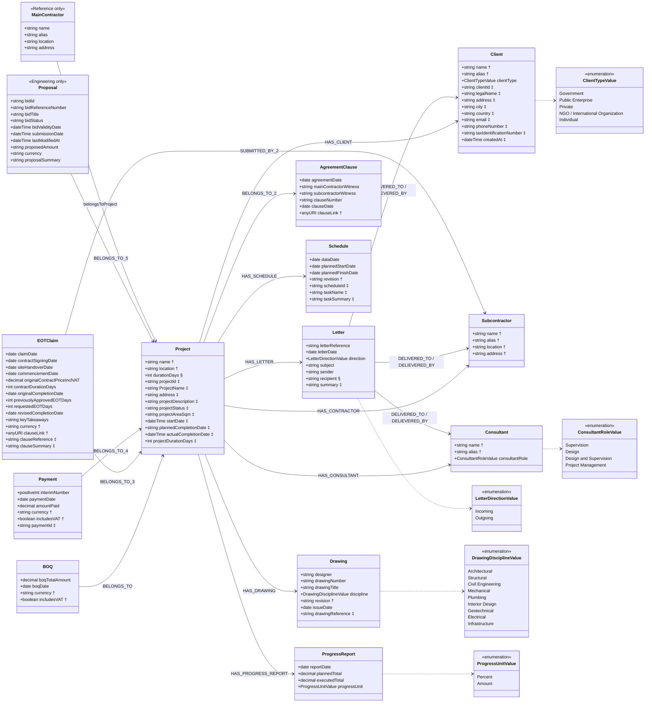
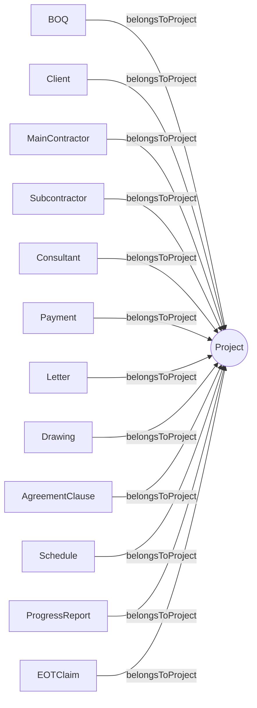
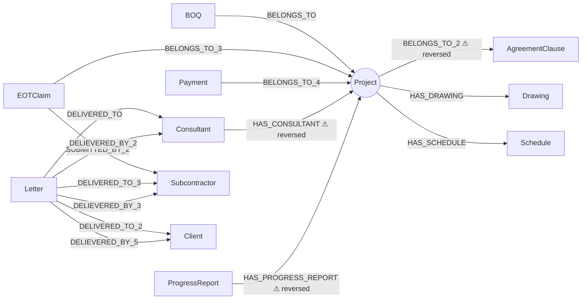
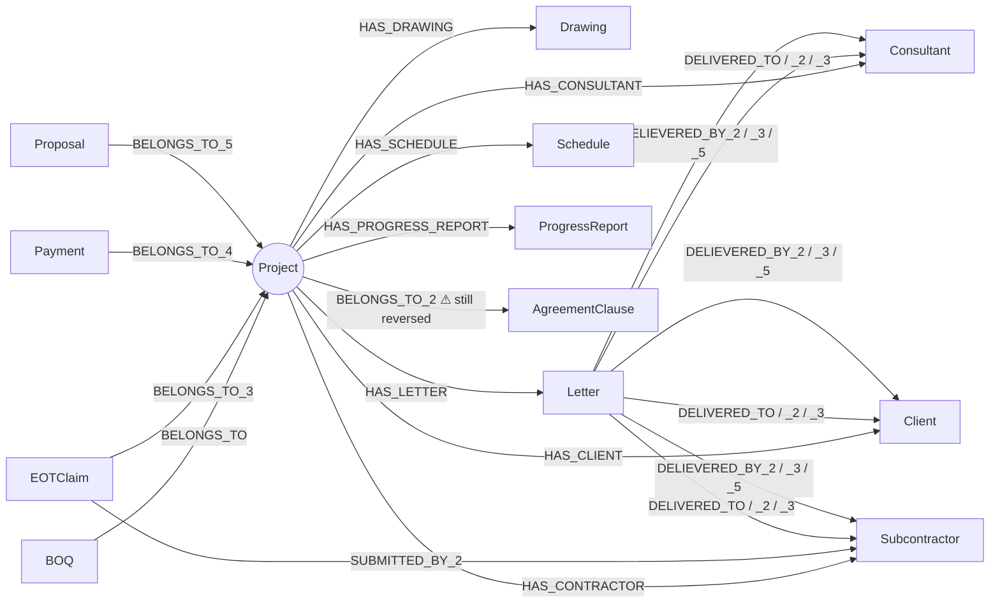

# Reference Ontology — consolidated view

> Historical comparison of the four earlier ontology snapshots. The current model is recorded in [model/model.tsv](../../model/model.tsv). See the [current model reference](../../model/README.md) for `Report`, `FinancialRecord` and their permitted relationships. The older labels and directions below belong to the compared snapshots.

Sources (all share namespace `https://example.org/ontology#`):

| File | Label | Style | Relationships |
|---|---|---|---|
| `archive/ontologies/schema_v0_2.ttl` | Reference KG Schema v0.2 | hand-written OWL, enums, unions | none |
| `archive/ontologies/schema_v0_4.ttl` | Reference KG Schema v0.4 | same + `designer`, comments | single `belongsToProject` (all → Project) |
| `archive/ontologies/ontology.ttl` | Ontology_1 | Fabric export | 14 named edges, mixed directions |
| `archive/ontologies/Engineering_ontology.ttl` | Engineering ontology | Fabric export, extended | 18 named edges + `Proposal` class |

v0.2 is a strict subset of v0.4, so v0.4 stands for "Reference" below.

Attribute markers in the class diagram: no marker = in both Reference and Fabric ·
`†` = Reference v0.4 only · `‡` = Fabric only (mostly Engineering) ·
`§` = Ontology_1 + Reference but dropped in Engineering.

## 1. Consolidated class diagram (union of all files)

Not drawn: `kg:identifier` (Reference, no domain — applies to every class).

## 2. How each file represents relationships

### Reference v0.4 — pure star, one predicate

### Ontology_1 (`archive/ontologies/ontology.ttl`) — named edges, inconsistent direction

Client and Letter have no path to Project; there is no MainContractor class.

### Engineering (`archive/ontologies/Engineering_ontology.ttl`) — Ontology_1 fixed and extended

## 3. Differences worth fixing

- **Direction is mixed.** `HAS_*` points Project → X; `BELONGS_TO*` points X → Project, except `BELONGS_TO_2`, which points Project → AgreementClause. Pick one direction.
- **Numbered predicate names** (`BELONGS_TO_2…5`, `DELIVERED_TO_2/3`) are Fabric artefacts of one predicate per domain/range pair. Each set is really one property with a union range.
- **Typo:** `DELIEVERED_BY_*` should be `DELIVERED_BY`.
- **MainContractor** exists only in Reference. Fabric's `HAS_CONTRACTOR` points to `Subcontractor`.
- **Enums lost in Fabric.** clientType, consultantRole, direction, discipline and progressUnit are plain `xsd:string` there.
- **Types drift.** Reference uses `xsd:date`; Fabric uses `xsd:dateTime`. Ontology_1 stores day counts and `interimNumber` as strings; Engineering fixes the day counts but `interimNumber`, `projectAreaSqm`, `proposedAmount` and `plannedCompletionDate` are still strings.
- **Semantic drift.** In Engineering, `fabric:clientType` is labelled `industrySector`. `letterReference` is redefined as a link to the document, not the reference number.
- **Duplicates.** Project has `durationDays` (Reference / Ontology_1) and `projectDurationDays` (Engineering), `name` and `ProjectName`. EOTClaim has `clauseLink` (Reference) and `clauseReference` (Engineering).
- **Dropped in Engineering:** `Letter.recipient` and `Project.durationDays`.
- **Reference-only shared properties:** identifier, name, alias, location, currency, includesVAT, clauseLink and revision.
