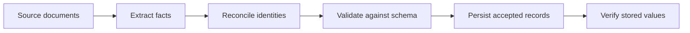

# Document-to-graph workflow

A general reference for turning source documents into structured knowledge graph records.

## Processing stages

1. Extract supported facts, document references and provenance.
2. Search existing records and reconcile identities using corroborating evidence.
3. Resolve related entities independently and retain stable identifiers.
4. Validate property types and relationships against the model.
5. Where applicable, associate a factual summary with its matching embedding.
6. Persist accepted facts and relationships.
7. Read back the stored values to verify the result; defer unresolved changes.

## Record identity and provenance

References, dates, parties, revision information and source provenance help distinguish existing records from new records. Similarity scores identify candidates; they do not establish identity on their own.

Missing or ambiguous input does not imply that a stored value should be cleared. Independent records can remain useful while uncertain relationships are unresolved.

## Summaries and embeddings

A summary and its embedding describe the same exact text. When a summary changes, its corresponding vector changes with it. Embedding metadata belongs to the model representation; a vector alone is not evidence of a record's identity.

## Earlier schema representations

| Earlier representation | Current representation |
|---|---|
| `ProgressReport` | `Report`, with `reportType=ProgressReport`. |
| `Payment` | `FinancialRecord`, with `recordType=Payment`; `amountPaid` maps to `amount` and `paidDate` to `effectiveDate`. |

These mappings describe schema evolution. Any data migration needs to preserve existing identifiers, provenance and verified relationships.

See the [model reference](../model/README.md) for supported properties and relationships.
